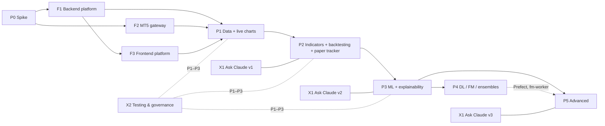

# SignalDeck — Implementation Plans (Django + Next.js)

These sub-plans turn the master plan (**`SignalDeck_Project_Plan.pdf`, Rev 2, 17 Oct 2026** — keep a copy at `docs/SignalDeck_Project_Plan.pdf`) into implementation plans you can build from directly. The master plan assumed FastAPI. **SignalDeck is built with Django (Ninja + Channels + Celery) and Next.js 16.** Every substitution is listed in the [decision log](#django-adaptation-decision-log) below.

## Reading order

| # | Plan | Type | Scheduled in | Hours |
|---|---|---|---|---|
| 1 | [P0 — Spike: MT5 connectivity](P0-spike-mt5-connectivity.md) | Phase | P0 | 12 |
| 2 | [F1 — Backend platform (Django)](F1-backend-platform-django.md) | Foundation | P1 (+1.5 h P2) | 25.5 |
| 3 | [F2 — MT5 gateway](F2-mt5-gateway.md) | Foundation | P1 (+2 h P2) | 20 |
| 4 | [F3 — Frontend platform (Next.js)](F3-frontend-platform-nextjs.md) | Foundation | P1 | 20 |
| 5 | [P1 — Data + live charts](P1-data-and-live-charts.md) | Phase | P1 | 27 own |
| 6 | [P2 — Indicator signals + backtesting](P2-indicator-signals-backtesting.md) | Phase | P2 | 47 own |
| 7 | [P3 — ML + explainability](P3-ml-and-explainability.md) | Phase | P3 | 73.5 own |
| 8 | [P4 — Deep learning, foundation models, ensembles](P4-deep-learning-foundation-models.md) | Phase | P4 | 55 (+3 stretch) |
| 9 | [P5 — Advanced: context, portfolio, monitoring, alerts](P5-advanced-monitoring-alerts.md) | Phase | P5 | 41 own |
| 10 | [X1 — Ask Claude advisor](X1-ask-claude-advisor.md) | Cross-cutting | v1 P2 · v2 P3 · v3 P5 | 25 + 16 + 16 |
| 11 | [X2 — Testing, quality, governance](X2-testing-quality-governance.md) | Cross-cutting | P1 · P2 · P3 | 11 + 7 + 7 |

## How to use these plans

- **Work package (WP) IDs** are `<plan>-WP<nn>` (e.g. `P2-WP09`). Each WP is 1–8 h, which fits one sitting or one Claude Code session.
- A WP's **acceptance criteria are its definition of done**.
- **Priority:** `M` = must, for the phase's exit criteria. `S` = should, and can slip to the next phase.
- Each plan follows the same template:
  1. Goal and context
  2. Scope
  3. Dependencies
  4. Design
  5. Work packages
  6. Testing
  7. Exit criteria (master wording copied exactly + measurable checks)
  8. Risks
  9. Verify-at-build-time
- With Claude Code, run **`/wp-start <WP-ID>`**. It loads the plan and acceptance criteria, checks dependencies, creates the `wp/` branch and marks the WP `doing`. Then implement. Then run **`/wp-done`**, which verifies each criterion with evidence, runs the matching reviewer subagent, updates [TRACKER.md](TRACKER.md) and commits. At a phase boundary, run `/phase-review <P#>`, and before fast-moving work, run `/verify-build <plan>`. The project's Claude setup (CLAUDE.md, `.claude/rules/`, hooks, skills, agents) is described in the root `CLAUDE.md`.
- Each phase plan has a **phase budget** table that includes the foundation and cross-cutting WPs scheduled in that phase.

## Before you start

1. **Move the repo out of OneDrive** (e.g. `C:\dev\signaldeck`), or exclude `.venv`, `node_modules` and `data/` from sync. OneDrive file locking breaks uv/pnpm installs and Docker volumes. See [F1 §8](F1-backend-platform-django.md#8-risks-and-mitigations).
2. Copy the master PDF into `docs/`.
3. Install Docker Desktop (WSL2 backend), uv, pnpm, just, Git, and the MT5 terminal + a broker demo account.

## Dependency graph

## Schedule and effort (bottom-up vs master)

| Phase | Master estimate | Bottom-up (all WPs in phase) | Lean (S items deferred) | Weeks at 10–12 h/wk |
|---|---|---|---|---|
| P0 | 1 wk | 12 h | 12 h | 1 |
| P1 | 3–4 wks | 100 h | 88 h | 8–10 |
| P2 | 4–5 wks | 82.5 h | 76 h | 7–8 |
| P3 | 5–7 wks | 96.5 h | 90 h | 8–9.5 |
| P4 | 4–6 wks | 55 h (+3 stretch) | 55 h | 5–6 |
| **P0–P4** | **17–23 wks** | **≈ 346 h** | **≈ 321 h** | **≈ 29–34** |
| P5 | ongoing | 57 h first pass | — | ongoing |

> **Honest note:** the bottom-up total is roughly 1.5× the master estimate. That is mostly because the master's Phase 1 does not account for setting up the Django/Channels/Celery/Timescale platform, the gateway hardening, and the test harness.
>
> If Claude Code implements most WPs, the hours should drop substantially. Re-estimate after F1 is done, using the real velocity.

## Django adaptation decision log

| # | Master plan (FastAPI stack) | SignalDeck decision | Where |
|---|---|---|---|
| D1 | FastAPI + uvicorn | Django 5.2 LTS (or current 6.x, verify) on uvicorn via ASGI | F1 §4.1 |
| D2 | FastAPI routers + pydantic v2 | **Django Ninja** (pydantic-native schemas, OpenAPI) | F1 §4.6 |
| D3 | FastAPI WebSocket `/ws` | **Django Channels** + `channels-redis`, same `{channel, symbol, payload, seq}` envelope | F1 §4.7 |
| D4 | `sse-starlette` | Async `StreamingHttpResponse` (`text/event-stream`); client uses fetch-stream parsing (POST) | F1 §4.1, X1 §4.6 |
| D5 | APScheduler / arq / Dramatiq | **Celery + beat** (Redis broker), in Docker. Prefect for ML DAGs from P4 | F1 §4.8, P4 §4.9 |
| D6 | Separate worker processes | Long-running Redis-Streams consumers as **Django management commands** (`ingest_streams`, `stream_fanout`, `bar_close_dispatcher`, `paper_tracker`, `alerts_engine`) | F1 §4.4 |
| D7 | SQLAlchemy / asyncpg | Django ORM (async methods) for metadata/ledgers. Hypertables via migration ops + `CompositePrimaryKey`. Bulk writes via psycopg `COPY` | F1 §4.9 |
| D8 | pydantic → TS | Ninja OpenAPI → `openapi-typescript`; `sd_contracts` JSON Schema → `json-schema-to-typescript` | F1 §4.10 |
| D9 | — | **Django admin** for symbols, settings, budget caps, ledgers | F1 §4.5 |
| D10 | Auth (unspecified) | Single-user Django session auth. Next.js rewrites make `/api` and `/ws` same-origin | F3 §4.3 |
| D11 | `apps/workers/` | Workers live in the Django project (Celery tasks + commands). `packages/*` stay framework-free (`sd_*` names) | F1 §4.2 |
| D12 | Gateway | Plain Python (`sd_gateway`), **never imports Django**, native Windows Python 3.12 | F2 |
| D13 | Foundation models in the main env | Separate **fm-worker** image/uv project (`sd_fm`) on Celery queue `fm` | P4 §4.1 |
| D14 | "FinBERT or LLM scoring" for news | FinBERT or **local** Ollama only. Claude is never automatic (deliberate-only) | P5 §4.3 |

## Traceability matrix (master plan → sub-plan WPs)

### Roadmap phases

| Master roadmap item | Implemented by |
|---|---|
| P0: gateway prints ticks for 3 symbols | P0-WP03 |
| P0: reconnect loop | P0-WP05 → F2-WP01 (supervisor in §4.5) |
| P0: UTC handling | P0-WP04 → F2-WP03 |
| P0 exit: 24 h run | P0-WP06 |
| P1: Gateway → Redis | F2-WP01, F2-WP02, F2-WP03, F2-WP05 |
| P1: → Timescale / Parquet | P1-WP01, P1-WP02, P1-WP04, F1-WP07 |
| P1: API WebSocket (→ Channels) | F1-WP04, P1-WP06 |
| P1: symbol picker, live candles, multi-pane, health banner | P1-WP07, P1-WP08, P1-WP09, F3-WP06, F3-WP07 |
| P1: monorepo, compose, typed WS contract | F1-WP01, F1-WP02, F1-WP08 |
| P1: history back-fill, symbol search (`symbols_get` groups) | P1-WP03, F2-WP04, F2-WP05, P1-WP05 |
| P1 exit: latency < 300 ms, gap-free M1 | P1-WP11 |
| P2: TA-Lib features; 3–4 rule strategies | P2-WP01, P2-WP02 |
| P2: vectorbt / backtesting.py; cost model | P2-WP05, P2-WP03, P2-WP04 |
| P2: signal ledger + paper tracker | P2-WP08, P2-WP09 |
| P2: animated pipeline v1; live feed + notifications | P2-WP11, P2-WP10 |
| P2: backtest page, metrics panel, cost sensitivity | P2-WP06, P2-WP07 |
| P2: Ask Claude v1 | X1-WP01 … X1-WP07 |
| P2 exit: paper tracker, baseline reports, Ask Claude in budget | P2-WP09, P2-WP14, X1 §7 |
| P3: triple-barrier, weights, meta-labeling | P3-WP02, P3-WP03, P3-WP04 |
| P3: LightGBM, purged CV, isotonic, Optuna, MLflow | P3-WP05, P3-WP06, P3-WP07, P3-WP11 |
| P3: SHAP waterfall, gauge, stepper, HMM regimes | P3-WP14, P3-WP15, P3-WP16, P3-WP09, P3-WP17 |
| P3: champion per group; explanation packets | P3-WP11, X2-WP09, P3-WP12 |
| P3: Ask Claude v2; Claude-vs-model agreement panel | X1-WP08 … X1-WP12 (panel: X1-WP11) |
| P3 exit: OOS expectancy > 0 at 1.5× or negative result | P3-WP13, P3-WP19 |
| P4: Chronos-2 / TimesFM 2.5 / Moirai 2.0 fan charts + quantile features | P4-WP01, P4-WP02, P4-WP03, P4-WP05 |
| P4: N-HiTS / PatchTST / TFT; attention heatmaps | P4-WP07, P4-WP08 |
| P4: stacking ensemble; ensemble vs champion | P4-WP09 |
| P4: NautilusTrader replay; Prefect DAGs | P4-WP10, P4-WP11 |
| P4 exit: ensemble beats champion, else keep | P4-WP12 |
| P5: MTF confluence; economic calendar; news/sentiment | P5-WP01, P5-WP02, P5-WP03 |
| P5: portfolio view; drift monitoring; alert rules | P5-WP04, P5-WP05, P5-WP07 |
| P5: LLM explanations; Ask Claude v3 | P5-WP08, X1-WP13 … X1-WP19 |
| P5 exit: drift triggers challenger retrain | P5-WP06 |

### Master sections

| Master section | Implemented by |
|---|---|
| §1 API surface, real-time pattern, gateway design, gotchas | F2-WP01 … F2-WP05, F2-WP09 |
| §1 platform options (decide host first — Rec. 1) | P0-WP01 (decision record) |
| §1 symbols & demo accounts | P0-WP01, F2-WP05 |
| §1 data-quality caveats in UI | P1-WP10, X1-WP02 (`dq_flags`) |
| §2 architecture, transport, Redis, scheduling, storage, monorepo, dev setup | F1-WP01 … F1-WP09, P4-WP11 |
| §3 plug-in model interface | P2-WP02 (`SignalModel` protocol) |
| §3 Layer 0 indicators | P2-WP01, P2-WP02 |
| §3 Layer 1 features | P3-WP01, P4-WP03 |
| §3 Layer 2 labels, weights, meta-labeling | P3-WP02, P3-WP03, P3-WP04 |
| §3 Layer 3 models (GBM, HMM, DL, FM, FinCast, ensembles) | P3-WP06, P3-WP09, P4-WP07, P4-WP02, P4-WP13, P4-WP09 |
| §3 Layer 4 calibration & confidence | P3-WP07, P3-WP15 |
| §3 Layer 5 signal policy | P2-WP08 (v0), P3-WP10 (v1), P5-WP02 (news suppression) |
| §4 backtesting stack | P2-WP04, P2-WP05, P4-WP10 |
| §4 validation protocol (WF, purged k-fold, CPCV, DSR, holdout) | P3-WP05, P3-WP08, X2-WP08 |
| §4 costs + sensitivity | P2-WP03, P2-WP06, P5-WP02 (news slippage) |
| §4 metrics panel | P2-WP04, P2-WP07, P3-WP08, P3-WP18 |
| §4 live paper-tracking (+ manual fill linking) | P2-WP09, F2-WP09 |
| §4 experiment tracking (MLflow, Optuna) | P3-WP06, P3-WP11 |
| §5 library choices; ticks outside React state | F3-WP01 … F3-WP07 |
| §5 visual 1 pipeline · 2 stepper · 3 SHAP · 4 gauge | P2-WP11/P3-WP17 · P3-WP16 · P3-WP14 · P3-WP15 |
| §5 visual 5 fan chart · 6 regime · 7 feed · 8 replay | P4-WP05 · P3-WP17 · P2-WP10 · P2-WP13 |
| §6 tree-model SHAP + stability | P3-WP12, P3-WP13 |
| §6 deep-model explainability | P4-WP08 |
| §6 FM ablation | P4-WP06 |
| §6 natural-language explanations (free default) | P5-WP08 |
| §7.1 design principles (deliberate, preview, advisor, grounded) | X1-WP05, X1-WP07, X2-WP02 |
| §7.2 advisor packet | X1-WP02, X1-WP08, X1-WP13 |
| §7.3 ask modes | X1-WP01, X1-WP09, X1-WP14 |
| §7.4 structured answer + UI | X1-WP01, X1-WP06, X1-WP10, X1-WP12 |
| §7.5 token/cost tactics | X1-WP03, X1-WP04, X1-WP15, X1-WP17 |
| §7.6 tracking Claude's advice | X1-WP11, X1-WP18 |
| §7.7 implementation notes (routes, secrets, resilience, storage, system prompt) | X1-WP03, X1-WP05 |
| Testing: unit | P2-WP01 … P2-WP04, P3-WP02 … P3-WP05 |
| Testing: leakage | X2-WP08 |
| Testing: contract | X2-WP04 |
| Testing: gateway fake + order grep | F2-WP06, F2-WP08, X2-WP02 |
| Testing: integration | X2-WP06 |
| Testing: frontend | F3-WP08, X2-WP07 |
| Testing: advisor | X1-WP07, X1-WP19 |
| Testing: model governance | X2-WP09 |
| Rec. 2 "no execution" structural | F2-WP08, X2-WP02 |
| Rec. 3 paper tracker in Phase 2 | P2-WP09 |
| Rec. 4 GBM before DL; promote only on DSR/Brier | P3, P4-WP12, X2-WP09 |
| Rec. 5 prefer H1/M15 | P2-WP14, P3 §9 defaults |
| Rec. 6 Claude must earn trust | X1-WP11, X1-WP18 |
| Rec. 7 make honesty visible | P3 §4.9 honesty badges (P3-WP15, P3-WP18), P2-WP07 (1.5× warning) |

## Status

Progress for every work package, phase exit criteria, and a decisions/blockers log are kept in **[TRACKER.md](TRACKER.md)**. That file is the single place to record status.

---
*Personal, educational project. Signals are model outputs with uncertainty, not recommendations. Nothing here suggests trading real money.*
